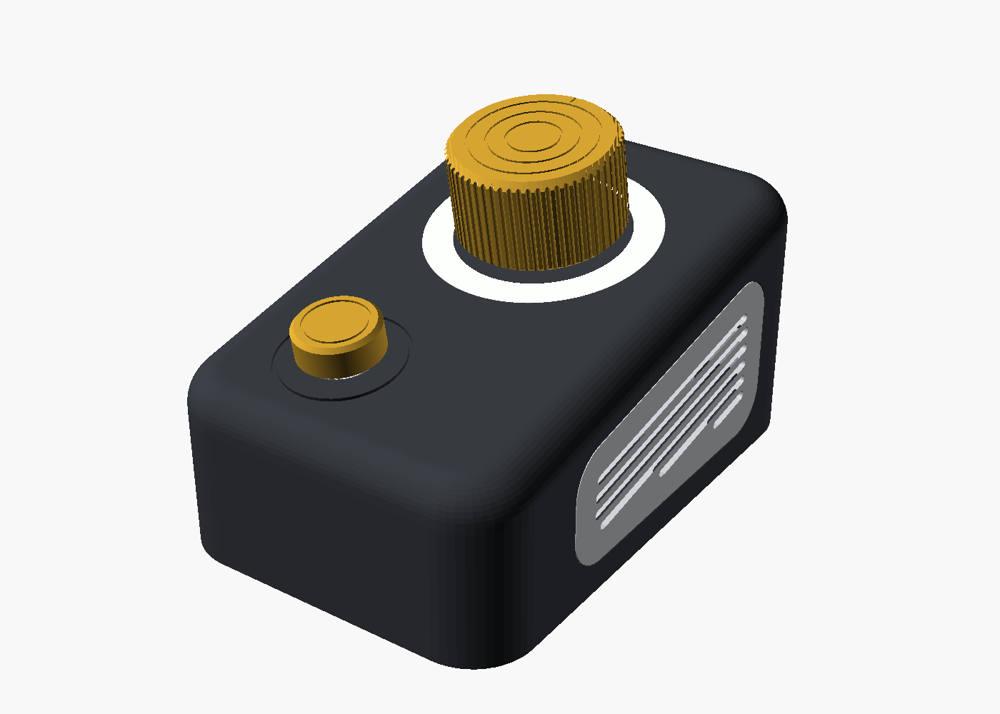
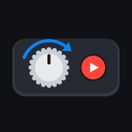
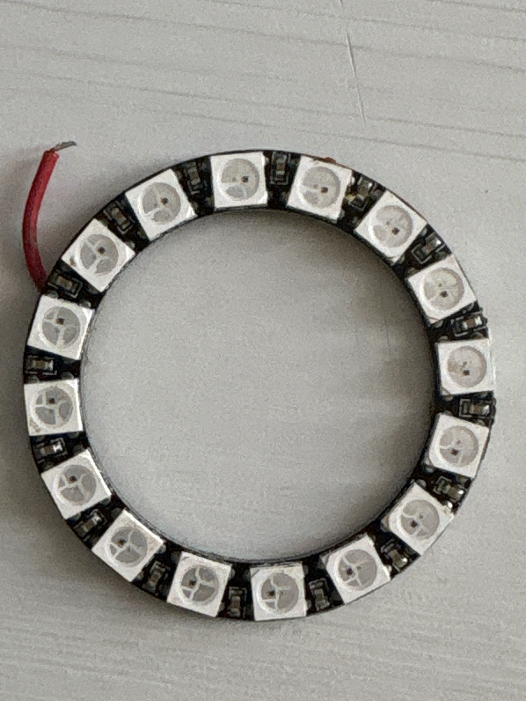
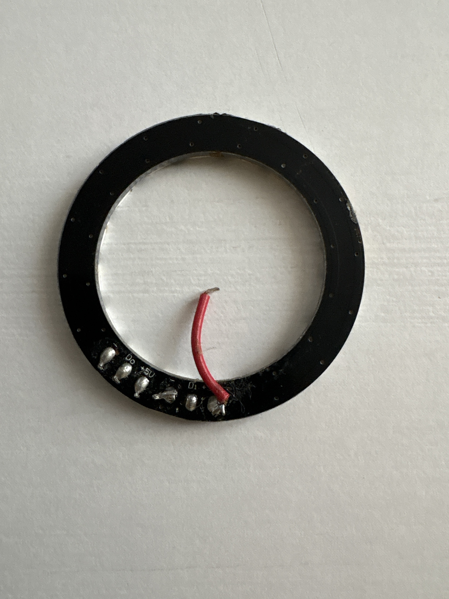
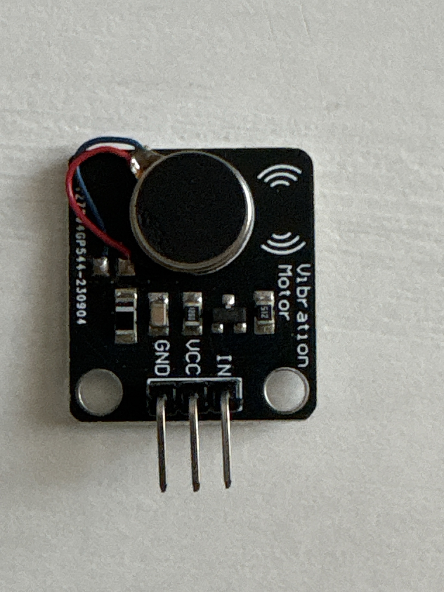
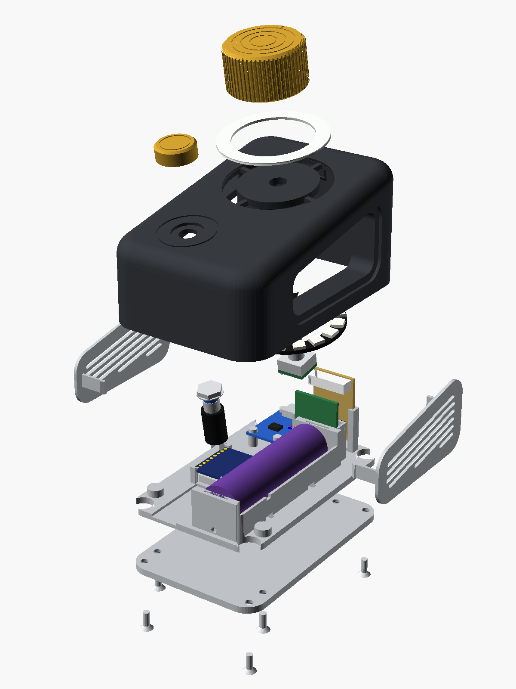
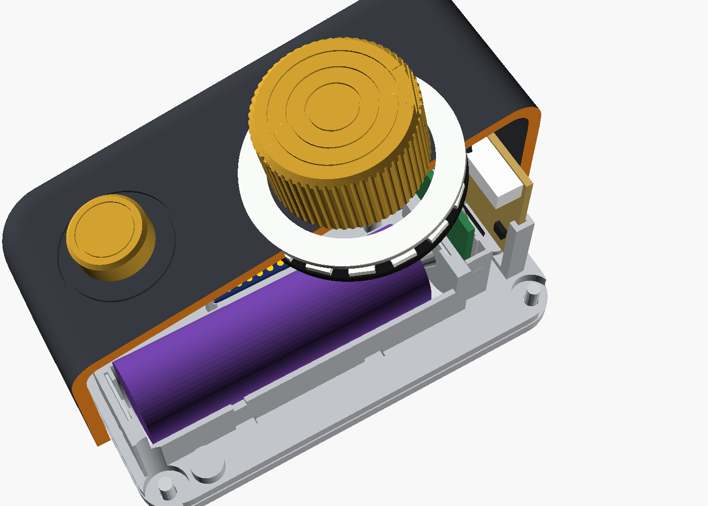
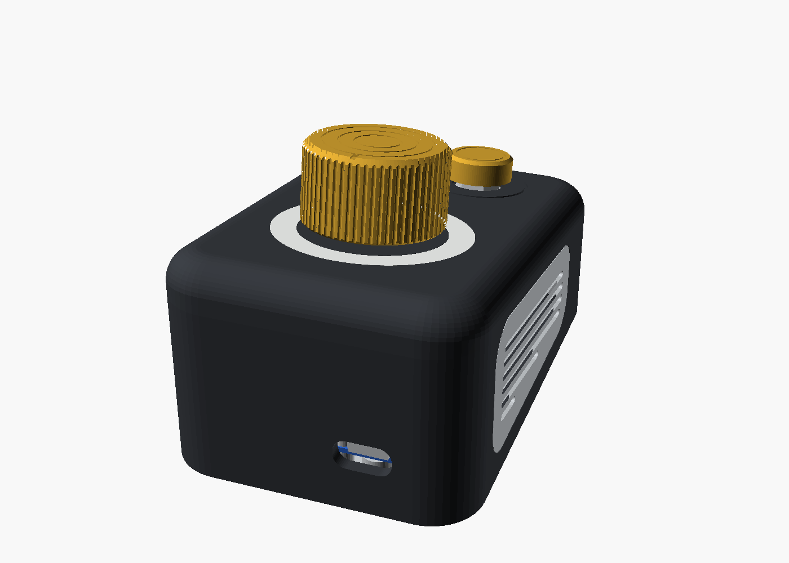
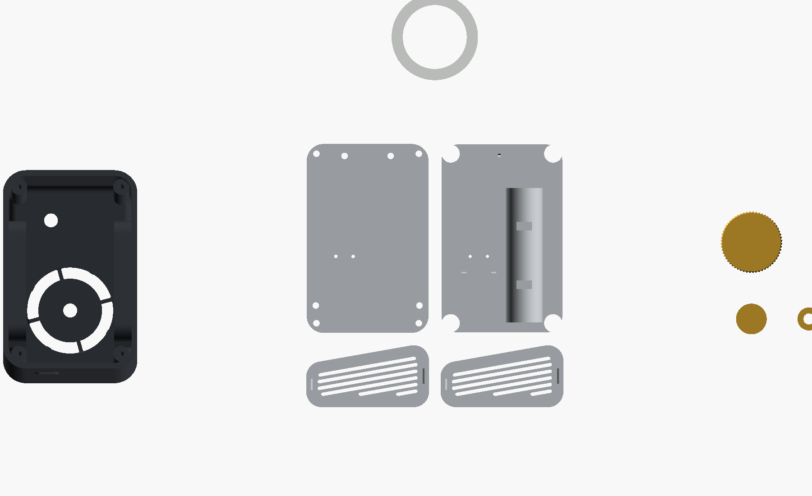
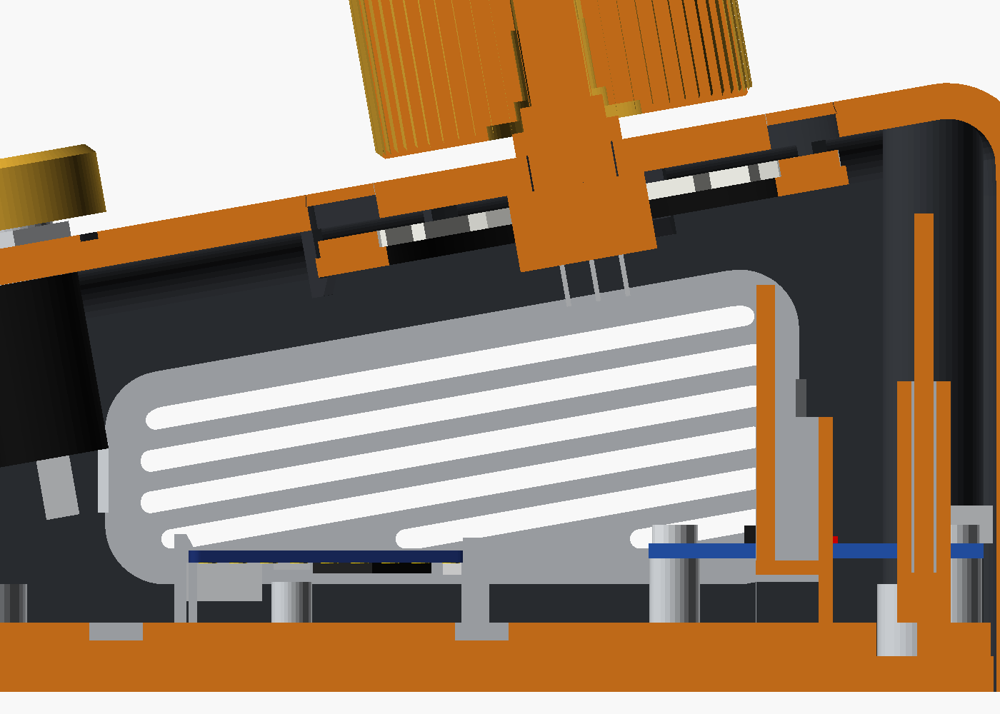

# YouTubeController

Controller fisico per YouTube su iPad: **una sola manopola, che si gira e si preme**, in una scatola stampata in 3D, collegati via Bluetooth a una **PWA** che cerca e riproduce i video.

- **Manopola**: avanti / indietro nel video, con passo che dipende dalla velocità di rotazione (fine / medio / veloce).
- **Pressione della manopola**: play / pausa; pressione media per il loop A-B tra due punti del video.
- **Anello di luce** attorno alla manopola e **vibrazione** per confermare i comandi senza guardare.



> Stato: in sviluppo. PWA utilizzabile; ESP32 arrivato, prototipo del firmware in partenza; scatola alla seconda versione (anello LED, vibrazione, PLA).
> Dettagli aggiornati in [`docs/STATO.md`](docs/STATO.md).

## Come funziona

```
 Manopola + pulsante ──► ESP32-S3 (firmware) ══ Bluetooth LE ══► iPad
                         si presenta come                       PWA in Safari / Home
                         TASTIERA BLE (HID)                     legge i tasti e comanda
                                                                il player YouTube (IFrame API)
```

Safari su iPadOS non supporta Web Bluetooth: per questo il controller si presenta come una normale **tastiera Bluetooth** e la PWA ascolta gli eventi tastiera. La velocità della manopola la misura il firmware, che invia un tasto diverso per ogni livello; la PWA somma gli scatti e fa un solo salto quando smetti di girare.

## La PWA

**Indirizzo:** https://pzero.github.io/YouTubeController/ (aprire in Safari sull'iPad → Condividi → *Aggiungi a Home*).



- Ricerca video (YouTube Data API v3, con la **propria chiave API** inserita nelle Impostazioni: resta solo sul dispositivo) o link/ID incollato.
- Preferiti salvati sul dispositivo, con punti del loop A-B e ultima posizione; esporta/importa in JSON.
- Seek a tre velocità con indicatore della posizione di arrivo; loop A-B; schermo pieno automatico al play.
- Sezione *Controller* nelle Impostazioni: gesti, aggiornamento firmware, WiFi.

Dettagli: [`app/README.md`](app/README.md).

### Tasti (inviati dal controller, provabili con qualsiasi tastiera)

| Comando | Tasto |
|---|---|
| Indietro / avanti, passo fine (1 s) | ← / → |
| Passo medio (5 s) | Shift + ← / → |
| Passo veloce (30 s) | Alt + ← / → |
| Play / pausa | Spazio |
| Loop A-B (1ª = A, 2ª = B e avvio, 3ª = cancella) | L |

Riferimento unico: [`app/js/keymap.js`](app/js/keymap.js).

### Gesti del controller

| Gesto | Effetto |
|---|---|
| Rotazione lenta / media / veloce | passo fine / medio / veloce |
| Pressione breve (< 0,7 s) | play / pausa |
| Pressione media (0,7–2 s) | loop A-B |
| Pressione 10 s / 2 s | standby / risveglio |
| Pulsante premuto + 5 scatti avanti | modalità aggiornamento firmware (OTA) |
| Pulsante premuto + 5 scatti indietro | azzera il WiFi di casa |

## Elettronica

| Componente | Ruolo |
|---|---|
| ESP32-S3 SuperMini | BLE HID tastiera, WiFi per gli aggiornamenti OTA |
| Encoder EC11 con albero zigrinato | manopola |
| Pulsante integrato nell'encoder | play / pausa, loop, gesti |
| Modulo TP4056 USB-C con protezione | ricarica (0,5 A) della 18650 |
| Batteria Li-ion 18650 | alimentazione |
| Anello WS2812B 16 LED (Ø45/Ø33) | alone di luce attorno alla manopola |
| Modulo vibrazione (motore a moneta) | conferma dei gesti |

<p>



</p>

Schema dei collegamenti, GPIO, consumi e piano OTA: [`firmware/README.md`](firmware/README.md).
Schedina millefori di interfaccia (layout, piste, ordine di saldatura): [`firmware/millefori/`](firmware/millefori/README.md).
Lista componenti con costi e alternative: [`docs/BOM.md`](docs/BOM.md).

**Aggiornamenti del firmware:** primo caricamento via USB (con la batteria scollegata), poi via WiFi (OTA): il firmware è compilato da GitHub Actions e pubblicato nelle *Releases*; con il gesto di aggiornamento il controller lo scarica da solo. Nessuna password nel firmware: la rete del controller e il WiFi di casa si configurano sulla scheda.

## Scatola

Modello parametrico **OpenSCAD** in [`enclosure/`](enclosure/): scocca, fondo e un **portaschede** intercambiabile avvitato al fondo che porta l'elettronica (se cambia un componente si ristampa solo quello). Stampa su Bambu Lab A1 mini (piatto 180×180) in più piatti.

| | |
|---|---|
|  |  |
|  |  |
|  | |

Tutte le misure condivise tra elettronica e scatola, con fonte e affidabilità: [`enclosure/dimensioni.md`](enclosure/dimensioni.md).

## Struttura del repository

| Cartella / file | Contenuto |
|---|---|
| `app/` | PWA (pubblicata su GitHub Pages); `app/test/` pagina di prova tastiera |
| `firmware/` | firmware ESP32 e documentazione elettronica |
| `enclosure/` | modello 3D OpenSCAD e quote |
| `docs/STATO.md` | stato attuale e prossimi passi |
| `docs/DECISIONI.md` | registro delle decisioni con motivazione |
| `docs/REQUISITI.md`, `docs/BOM.md` | requisiti e componenti |
| `docs/render/`, `docs/foto/` | render della scatola e foto dei componenti |

## Sicurezza

Repository pubblico: **nessuna chiave o password** nei file. La chiave API YouTube sta solo nelle impostazioni della PWA sul dispositivo; le credenziali WiFi solo nella memoria del controller.

## Licenza

[MIT](LICENSE) per tutto il progetto: codice (PWA e firmware), modello 3D e documentazione. Su MakerWorld il modello 3D è pubblicato con licenza CC BY 4.0.
